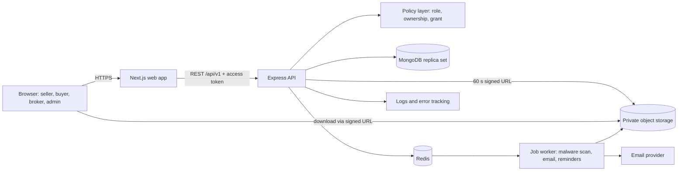
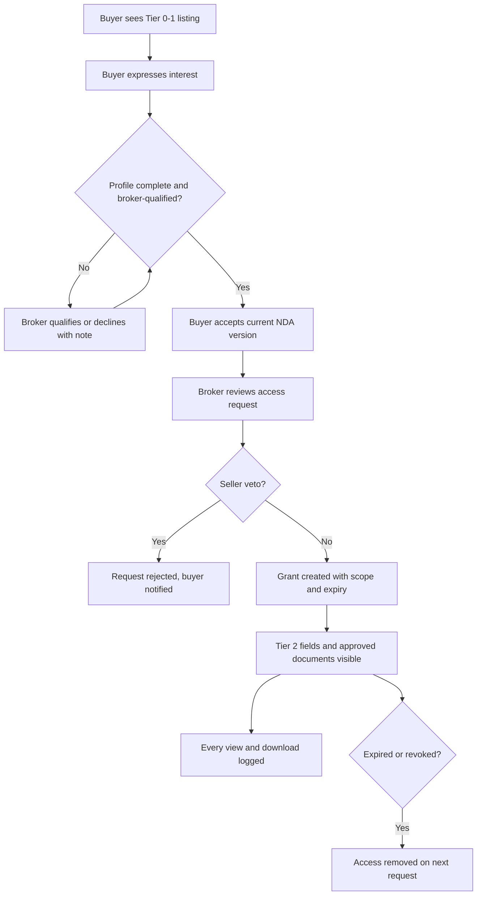

> Historical prototype document. The active multi-specialty implementation and decisions are documented in IMPLEMENTATION.md, AUTHORIZATION.md, API.md and OPERATIONS.md. Conflicting India-only, Redis, token-auth or automated-valuation descriptions below are superseded.

# System Architecture

## Overview
The Dental Practice Transition Brokerage Platform is an India-first broker-led transaction system. It pairs confidential discovery with a managed deal workspace.

## Disclosure Workflow

## Transaction Lifecycle (13 Stages)
1. New Lead
2. Buyer Qualified
3. NDA Acceptance
4. Information Disclosure
5. Due Diligence (Hard Gate: Checklist completion required)
6. Initial Offer
7. Negotiation
8. Letter of Intent
9. Legal Review
10. Final Agreement
11. Closing
12. Ownership Transition
13. Post-Sale Handover
Terminal: Lost, Withdrawn.

